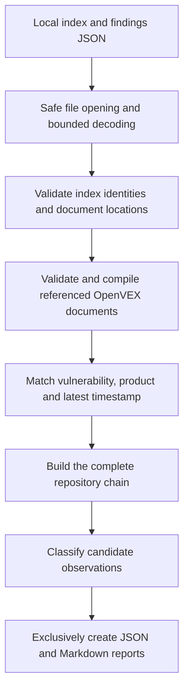

# Architecture and decision rules

The runtime is one standard-library Python module, designed for direct inspection rather than a framework or plugin system.

| Component | Responsibility |
| --- | --- |
| `open_directory`, `read_json`, `inside_repo` | Descriptor-based file access, regular-file requirements, safe locations and bounded JSON. |
| `parse_purl`, `index_key`, `applies` | Supported identity normalization, OCI repository identity and directional product matching. |
| `date_value` | Parse the accepted RFC3339 profile into integer nanoseconds. |
| `compile_document`, `Document.verdict` | Validate decision fields, compile statements by identifier and select an unambiguous latest status. |
| `Repository` | Load index entries and lazily cache documents referenced by supplied findings. |
| `run_audit`, `Budget` | Preserve explicit priority, evaluate chains and enforce shared budgets. |
| `render_markdown`, `write_reports`, `main` | Escape displayed data, create fresh reports and return controlled CLI errors. |

## Matching

Index lookup excludes version, qualifiers and subpath, except OCI's `repository_url`. A statement PURL is the general side of a comparison: its explicit version must equal the finding version, and every statement qualifier must occur with the same value on the finding. A versionless statement can match a versioned finding. No version ranges are evaluated.

Normalization is limited to the listed package types. Case-sensitive Maven identifiers remain distinct; percent-encoding is decoded before comparison, and plus signs retain their literal meaning. These rules are a declared consumer profile, not a claim of full PURL-spec conformance.

Statements match vulnerability names, aliases or identifiers. Matched histories with different primary names are rejected: the referenced upstream library orders such cases by primary name before timestamp, and the tool does not invent equivalence. Otherwise the latest timestamp is selected, preserving nanoseconds. Different statuses at the same latest timestamp cause an error rather than an order-dependent guess.

## Classification

The first repository whose index contains the package is authoritative in this model. A later `not_affected` or `fixed` produces a candidate only when that first repository has no applicable statement, or an explicit `affected`/`under_investigation` status. All qualifying later repositories are recorded.

Invalid documents and unsupported formats are errors, never silence. The distinction between absence of a vulnerability statement and absence of an applicable product appears in each finding's chain. A repository can be indexed even when its document has no applicable statement.

Compiled documents avoid scanning statements for unrelated vulnerabilities. Repeated identical `(purl, vulnerability)` queries reuse evaluated chains while retaining every original finding index. Work still depends on relevant statements/products, and the comparison budget can abort a large history.

## Filesystem and failure model

Directories are walked from `/` using pinned directory descriptors and no-follow flags. Leaf inputs are opened without following symlinks and must be regular files. Both report destinations are checked before exclusive creation. Ordinary write errors trigger cleanup of newly created reports.

This is not a whole-input snapshot, a defense against every hard-link or hostile concurrent mutation, or a crash-atomic pair of output files. The input directories must remain under the caller's control. No network, subprocess, plugin loading or VEX rewriting occurs in the runtime.
